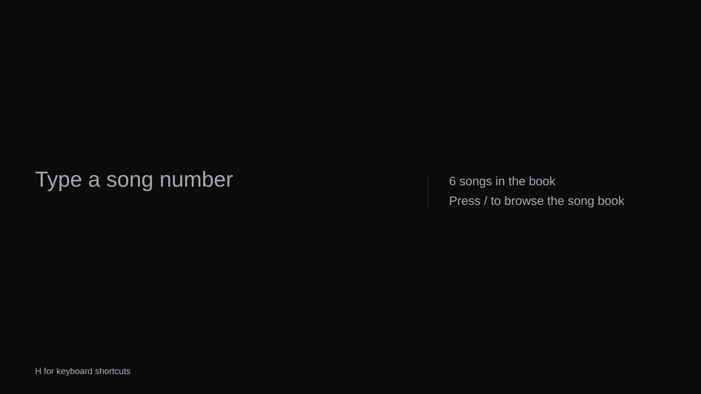

<div align="center">
  
  <h1>Kuraoke Kami</h1>
  <p><strong>An offline home karaoke machine for Omarchy / Hyprland.</strong></p>
  <p>Type a song number → Enter → sing. Big word-by-word lyrics, your own legally owned files, nothing leaves your machine.</p>

  <p>
    
    
    
    
    
    
    
    
    
  </p>
</div>

<p align="center"></p>

Linux only, shaped around Omarchy and Hyprland. A small Python server (standard library, no pip) plays the audio with
`mpv`, renders MIDI with `fluidsynth` and mixes stems with `ffmpeg`. The screen is a Chromium app window, so it tiles like
any other Hyprland window; **F** makes it fullscreen. Everything stays on this machine: the server listens on `127.0.0.1`
only.

## The journey

```text
Drop songs in a folder (or Settings → Import)
  → scan at startup, then the folder is watched: new songs appear within ~10 s
  → every file gets a stable song number (a rename keeps it)
  → type 10002 + Enter (or browse the song book)
  → intro screen: number, title, artist, what is up next
  → sing: lyrics fill word by word, key / tempo / melody / chorus change live
  → next song starts by itself
  → close the window: everything stops
```

| Stage | What happens |
|---|---|
| **Scan** | Folders are walked at startup and watched while the app runs (`karaokeimp` also tells an open app to rescan). Numbers are stored per file, so rescans and renames never renumber; each folder has its own start number (`10000`, `20000`...). |
| **Reserve** | By number on the keyboard or from the song book. Queue: add, sing next, remove. |
| **Intro** | A few seconds with the song number, title, artist and the next song. `Space` skips it. |
| **Sing** | Lyrics sit in the middle of the screen, two lines at a time, with count-in dots before the first line and after long breaks. |
| **Close** | Closing the window (or **Settings → Quit**) stops the server and mpv. |

## What’s on screen

| Surface | Role |
|---|---|
| **Stage** | The TV window: idle screen with a key cheat sheet, intro, lyrics, a small key / tempo strip, the “Up next” bar. |
| **Song book** (`/`) | Search by number, title or artist. **＋** reserves, **⤒** sings next. Each row shows its lyrics status (word / line / suspect / none; MIDI and CDG say embedded) and a **Missing lyrics** filter narrows the list. Language chips filter too. |
| **Queue** (`Q`) | Reorder, remove, clear. |
| **Settings** (`S`) | Folders and start numbers, language / country filters, duplicate filter, intro length, SoundFont, **Import** (the inbox), language (English / Tagalog), Quit. |

<table>
  <tr>
    <td width="50%" align="center"></td>
    <td width="50%" align="center"></td>
  </tr>
</table>

## Song formats

| Type | Drop in | Lyrics |
|---|---|---|
| **MIDI / KAR** | `.mid` `.midi` `.kar` | lyric events or KAR text events, per-word timing |
| **MP3** (wav, flac, ogg, m4a, opus) | `Artist - Title.mp3` | optional `Artist - Title.lrc` next to it (plain or word-timed) |
| **MP4** (mkv, webm, m4v; H.264) | video with burned-in lyrics | optional `.lrc`; a second audio track is the guide vocal |
| **CDG** | `.cdg` + same-name audio | drawn from the CDG graphics (decoded in the browser) |
| **Chorus** | a [Clone Hero](https://wiki.clonehero.net/) song folder: `song.ini` + `notes.mid` or `notes.chart` + audio | `PART VOCALS` lyrics with phrase breaks |

File names `Artist - Title` (optionally prefixed by a disc code such as `SC1234-05 - `) give artist and title.

### Melody and chorus

These are real, separate tracks, so they switch on the fly. If a song has no such track the button is greyed out.

| Source | Melody (lead / guide) | Chorus (backing) |
|---|---|---|
| **Chorus folders** | `vocals.*` | `vocals_1.*` `vocals_2.*` `harmony*` `backing*` |
| **MIDI / KAR** | tracks named *melody, vocal, voice, vox* | tracks named *chorus, backing, harmony, choir* |
| **MP4** | audio track 2 | none |
| **MP3 / CDG** | none | none |

MIDI is rendered once per song with `fluidsynth` into three stems (cached in `~/.cache/kuraoke-kami/`), then mixed live.
Key shifting uses `rubberband`, tempo uses mpv’s own pitch-preserving speed, so the lyrics stay in sync at any tempo.

## Keyboard

Click the window once, then:

| Key | Action | Key | Action |
|---|---|---|---|
| `0-9` `Enter` | reserve by number | `+` / `-` | key up / down (±12 semitones) |
| `Space` | pause / skip intro | `[` / `]` | tempo slower / faster (50–150 %) |
| `N` | next song | `M` / `C` | melody / chorus on / off |
| `,` / `.` | lyrics earlier / later (±0.25 s; `<` `>` ±2 s) | `T` | tap-to-sync: `←` `→` pick a line, `T` / `Enter` sets it |
| `L` | find lyrics: pick a match from lrclib | `R` | restart |
| `↑` / `↓` | volume | `F` | fullscreen |
| `/` | song book | `Q` `S` | queue / settings |
| `Tab` | menu | `H` `Esc` | key help / close |

Key and tempo reset for every song. Melody, chorus and volume are remembered. Lyric offsets are saved with the song, in
its `.lrc`.

## Lyrics: status, finding, syncing

Every song in the book carries a lyrics status, shown in the song book:

| Status | Meaning |
|---|---|
| `word` | `.lrc` with per-word timings: the fill follows every word |
| `line` | `.lrc` timed per line; the words are spread across the line (approximate) |
| `suspect` | saved, but the timing looks like another cut of the song: press **T** and fix it |
| `none` | no lyrics yet |
| `embedded` | MIDI / KAR / Chorus folder: the lyrics are inside the file |
| `cdg` | CDG: the lyrics are drawn by the graphics |

The **Missing lyrics** filter in the song book shows `none` and `suspect` only; `karaokedoctor` prints the same two counts.

**Find lyrics in the app (`L`).** With a song playing (or picked in the book), press **L**: artist and title are
pre-filled from the file name, and you can edit them (a typo in the file name no longer means renaming the file). lrclib
is asked for the exact artist + title + length first, then for artist + title, then as free text, then **title only**,
which catches a misspelled artist. `karaokeimp` / `karaokelrc` pick a match on their own only when its artist is the same
or nearly the same (`Fedezz` → `Fedez` yes, another singer's song with the same title no). The results are ranked: timed lyrics before plain, closest length first, and anything
more than 20 s off is left out. Each candidate shows artist, title, album, length, how far that is from your file and its
first lines. Pick one: it is written next to the song as `Artist - Title.lrc` (an existing `.lrc` is kept once as
`.lrc.bak`), and a playing song reloads at once. This is for audio and video files: MIDI, Chorus and CDG songs carry
their lyrics inside the file.

**Tap-to-sync (`T`).** Small drifts are fine with the nudges, but a video with a long intro needs one press. Press **T**
when the singer reaches a line, choose the line with **←** / **→** (usually the first line they are about to sing), then
press **T** or **Enter**: the app computes one offset, `now − line start`. Trim it afterwards with **,** / **.** (0.25 s)
or **<** / **>** (2 s); the new value pops up on screen.

**Where the offset lives.** Inside the `.lrc`, as the standard `[offset:N]` tag, in milliseconds (LRC's sign convention: a
positive value shows the lyrics earlier). It survives a rename, a move, or copying the folder to another machine. The
first tap or nudge also clears the `suspect` mark. MIDI / KAR / Chorus / CDG have no `.lrc`, so their offsets stay in the
config file; on the first start after upgrading, offsets saved in the old config are written into the matching `.lrc`
files.

When lrclib only has plain lyrics (no times at all), the app still saves them: line times are spread between 8 % and 92 %
of the track and the file is marked `untimed`, so it shows as `suspect` in the book. They are readable and singable, but
the timing is a guess; **T** and the nudges work on them like on any other file.

## Adding songs: `karaokeimp` or the in-app Import

```fish
karaokeimp --dry-run     # show the plan, change nothing
karaokeimp               # ask, then move
```

Takes freshly downloaded songs and: cleans the name to `Artist - Title.ext` (drops “(Official Video)”, video ids, ALL CAPS),
keeps CDG + audio pairs and Chorus folders together, fetches **timed lyrics** from [lrclib.net](https://lrclib.net) (free,
community; only artist, title and length are sent), moves everything into `songs/`, registers the folder and rescans so
the songs get their numbers. An app that is already open is told to rescan, so the songs show up in a second or two. It
never overwrites. `karaokelrc` fetches lyrics again for songs that still have none. Step-by-step in **[USERGUIDE.md](USERGUIDE.md)**.

The same importer sits in the app: **Settings → Import** lists what is waiting in the inbox folder (`~/Downloads` by
default), one line per song with a checkbox; **Import** moves the picked ones into your library folder, fetches their
lyrics and rescans. Same rules as `karaokeimp`: names are cleaned, nothing is overwritten.

## Install

```bash
sudo pacman -S mpv ffmpeg fluidsynth soundfont-fluid   # soundfont-fluid: MIDI/KAR
git clone https://github.com/nodaysidle/kurakami.git
cd kurakami
./install.sh      # `kuraoke-kami` and `karaokeimp` commands, an icon, and Apps → Kuraoke Kami in the Omarchy menu
```

Needs a Chromium-based browser for the app window (Omarchy default; Helium and Chromium both work). `omarchy-launch-webapp`
is used when it is there.

**First run:** open **Kuraoke Kami** from the menu, press `S`, add a folder with a start number (for example `10000`) and
click **Add folder & scan** — the scan starts by itself. Then type a song number and press Enter. After that, anything
dropped into the folder shows up within ten seconds. No songs yet? `python3 tests/fixtures.py ~/karaoke-demo` makes one
demo song of every format (needs ffmpeg).

## Where things live

| What | Where |
|---|---|
| Preferences, local API token | `~/.config/kuraoke-kami/config.json` |
| Song book | `~/.local/share/kuraoke-kami/library.db` |
| Lyrics and sync offsets | `Artist - Title.lrc` next to each song (`[offset:]` lives there) |
| Rendered MIDI / stem cache | `~/.cache/kuraoke-kami/` (safe to delete) |
| Your songs | wherever you add them (the repo’s `songs/` is git-ignored) |

## Stack

| Layer | Technology |
|---|---|
| Server | Python 3, `http.server`, `sqlite3`: standard library only, loopback only |
| Audio | `mpv` over JSON IPC; live mixing via `lavfi-complex`; `rubberband` for key |
| MIDI | own SMF reader / writer; `fluidsynth` + any `.sf2` / `.sf3` SoundFont |
| Stems | `ffmpeg` (`amix`, FLAC in Matroska) |
| UI | vanilla JS and CSS, no build step; CDG decoder in `web/cdg.js`; own i18n (English, Tagalog) |
| Window | Chromium app window via `omarchy-launch-webapp`; fullscreen / close through `hyprctl` |
| Lyrics | MIDI / KAR events, Clone Hero `PART VOCALS`, `.chart` events, LRC (line or word timed); lrclib lookup with candidate picking |

```text
kuraoke_kami/   lyrics.py  library.py  player.py  engine.py  server.py  lrclib.py  importer.py  config.py
web/            index.html  app.js  cdg.js  lyricpage.js  i18n.js  style.css
tools/          import_songs.py (karaokeimp)  fetch_lrc.py
tests/          test_core.py  test_pipeline.py  test_lyricpage.js  fixtures.py
```

## When something goes wrong

```fish
karaokedoctor              # tools, SoundFont, folders, lyrics count, audio, last errors (also: Settings → Diagnostics)
kuraoke-kami --logs        # the log: ~/.local/state/kuraoke-kami/kuraoke.log
```

Failures are logged with a full traceback (a bad file, a missing SoundFont, an mpv error, a crashed request, a JavaScript
error in the window). A song that cannot play shows its error on screen for five seconds and the queue moves on.

## Tests

```bash
python3 -m unittest discover -s tests -v   # 55 tests: parsers, numbering, renames, lyrics status, filters, lrclib, import planning, mixer graph
node tests/test_lyricpage.js               # which lyric lines are on screen
```

Verified on Arch / Omarchy with Hyprland 0.56: every format played through the live server, key / tempo / melody / chorus
changed during playback, real MIDI rendering with FluidR3, queue and auto-advance, the unplayable-file path, window
open / close.

## Privacy

No accounts, no telemetry, no analytics, nothing listens on your network. The only network calls are the optional lyrics
lookups in `karaokeimp`, `karaokelrc` and the in-app **Find lyrics** (`L`), which send the artist, title and track length
to lrclib.net. Use it for songs you own.

## Known limits

- Titles and artists come from file or folder names, not embedded tags.
- `.mpg` / `.avi` videos are skipped (the browser cannot decode them). Convert: `ffmpeg -i in.mpg -c:v libx264 -pix_fmt yuv420p -c:a aac out.mp4`.
- `.sng` files and zipped CDG are not read; unpack them first.
- Plain (line-timed) LRC spreads each line’s words evenly, so word timing is approximate; word-timed LRC and MIDI are exact.
- lrclib plain-only matches are saved with guessed line times (8 %–92 % of the track) and marked `untimed`: readable, roughly in time, not exact.
- Chorus word highlighting is capped at 3 s per word (note lengths are not read).
- CDG fine-scroll offsets are ignored; whole-tile scrolls work.
- A rename keeps the song number when the file itself is unchanged (`mv`, `rename`); rewriting the file at the same time gives it a new number.
- Lyrics for a song come only from lrclib or from an `.lrc` you add yourself.

## License

[MIT](LICENSE). The songs and lyrics you add are yours and stay on your machine.
