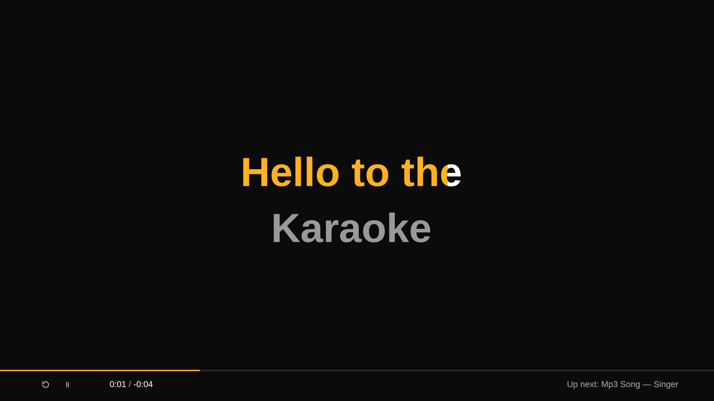
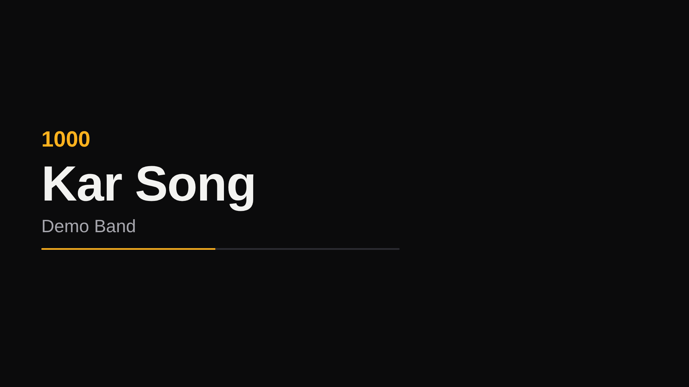

<div align="center">
  
  <h1>Kuraoke Kami</h1>
  <p><strong>An offline home karaoke machine for Omarchy / Hyprland.</strong></p>
  <p>Type a song number → Enter → sing. Big word-by-word lyrics, your own legally owned files, nothing leaves your machine.</p>

  <p>
    
    
    
    
    
    
    
    
    
    
  </p>
</div>

<p align="center"></p>

Linux only, shaped around Omarchy and Hyprland. A small Python server (standard library, no pip) plays the audio with
`mpv`, renders MIDI with `fluidsynth` and mixes stems with `ffmpeg`. The screen is one Chromium app window that tiles like
any other Hyprland window; **F** makes it fullscreen. Everything is driven from the keyboard, and everything stays on this
machine: the server listens on `127.0.0.1` only.

**Using it:** the complete user guide is **[USERGUIDE_V2.md](USERGUIDE_V2.md)**. The `karaokeimp` command-line walkthrough
is in [USERGUIDE.md](USERGUIDE.md).

## The journey

```text
Download songs → Settings → Import (or `karaokeimp`, or just drop files in a song folder)
  → names cleaned, timed lyrics fetched, songs get stable numbers (a rename keeps them)
  → the app scans at startup and watches its folders: new songs appear within ~10 s
  → type 10050: the song shows under the digits → Enter
  → intro: number, title, artist, countdown, a warning if lyrics are missing or doubtful
  → sing: lyrics fill word by word; key / tempo / melody / chorus change live
  → lyrics off? T taps them into sync. No lyrics? L finds them.
  → next song starts by itself; close the window and everything stops
```

## On screen

<table>
  <tr>
    <td width="50%" align="center"></td>
    <td width="50%" align="center"></td>
  </tr>
</table>

| Surface | What it does |
|---|---|
| **Idle** | A big number slot. While you type, the matching song (title, artist, lyrics mark) appears under it; **Enter** reserves. Beside it: what is queued next, or how many songs you have. |
| **Intro** | Song number, title, artist and a countdown bar. Warns when the song has no lyrics (“press L”) or doubtful lyrics (“press T”). **Space** skips it. |
| **Lyrics** | Two lines in the middle, sung words turn amber, count-in dots before the first line and after long breaks. Bottom strip: progress, elapsed / remaining, restart / pause, Up next. Key / tempo / melody / chorus changes show for two seconds top-right, only when not at default. |
| **Song book** (`/`) | A wide panel: search by number, title or artist; language chips; **Missing lyrics (N)** filter; a lyrics mark per row. `↑` `↓` move, `Enter` adds, `Shift+Enter` sings next, `L` finds lyrics; clicking a row shows the same actions. |
| **Find lyrics** (`L`) | Editable artist / title, ranked lrclib matches with album, length, Δ to your file, timed or plain, first lines. Pick one and it is saved and shown at once. |
| **Tap-to-sync** (`T`) | One lyric line, big. `←` `→` choose it, `T` / `Enter` the moment it is sung, `Esc` cancels. |
| **Queue** (`Q`) | Move to top, remove, clear; **U** undoes a clear. |
| **Settings** (`S`) | General (language, intro length, hide duplicates), Library (folders, start numbers, scan), Import (inbox), Audio (SoundFont), Diagnostics, Keyboard shortcuts, Advanced (rebuild database, typed confirmation; Quit). |
| **Error** | The reason and “Skipping in 5 s”, then the queue moves on. |

The look is deliberately plain: flat black, white lyrics with a thick outline, one amber accent, real SVG icons, sentence
case. Respects `prefers-reduced-motion`; every control is labelled and reachable by keyboard.

## Keyboard

Click the window once, then:

| Key | Action | Key | Action |
|---|---|---|---|
| `0-9` `Enter` | reserve by number (`Backspace` deletes) | `+` / `-` | key up / down (±12 semitones) |
| `Space` | pause / skip intro | `[` / `]` | tempo slower / faster (50–150 %) |
| `N` / `R` | next song / restart | `M` / `C` | melody / chorus on / off |
| `T` | tap-to-sync the lyrics | `,` / `.` | lyrics earlier / later (0.25 s) |
| `L` | find lyrics | `<` / `>` | lyrics earlier / later (2 s) |
| `/` or `Tab` | song book | `↑` / `↓` | volume |
| `Q` / `S` | queue / settings | `F` | fullscreen |
| `U` | undo (clear queue) | `H` / `Esc` | shortcuts / close |

Key and tempo reset for every song. Melody, chorus and volume are remembered. Lyric offsets are saved in the song’s `.lrc`.

## Adding songs

Three ways, same rules:

- **In the app:** **Settings → Import → Check inbox** lists every song in the inbox folder (`~/Downloads` by default),
  ticked, with its cleaned name and lyrics state. **Import selected** moves them into your library.
- **`karaokeimp`** in a terminal (`--dry-run` first). See [USERGUIDE.md](USERGUIDE.md).
- **Drop files** into a song folder yourself. The watcher picks them up within ten seconds.

The importer cleans names to `Artist - Title.ext`: it drops “(Official Video)”, “Video Ufficiale”, yt-dlp video ids,
`- Topic` and ALL CAPS, turns `_` into spaces, and understands YouTube-style titles such as `M83 'Midnight City'`,
`Artist “Title”`, `Artist – Title` and `Artist | Title`. With no artist in the name it reads the embedded tags. CDG + audio
pairs and Clone Hero folders stay together. It fetches timed lyrics from [lrclib.net](https://lrclib.net), never overwrites,
skips songs already in the book (by file name and by normalised artist + title), and tells an open app to rescan.
`karaokelrc` fetches lyrics again for every song that still has none, across all your folders.

**Song numbers are stable.** Each folder counts from its own start number (`10000`, `20000`…). Rescans keep numbers, and a
renamed file keeps its number and its lyric timing, so fixing a typo in a name is safe.

## Lyrics: status, finding, syncing

Every song has a lyrics status, shown as a mark in the song book and on the number preview:

| Status | Mark | Meaning |
|---|---|---|
| `word` | ✓ | `.lrc` with per-word times: the fill follows every word |
| `line` | ✓ | `.lrc` timed per line; words are spread across the line |
| `suspect` | amber warning | the lyrics run past the end of the file or stop before its halfway point (likely another cut of the song), or they were untimed. A long instrumental outro alone is fine |
| `none` | “No lyrics” | nothing found yet |
| `embedded` / `cdg` | none | MIDI / KAR / Clone Hero lyrics inside the file, or CDG graphics |

The **Missing lyrics** filter and `karaokedoctor` count `none` and `suspect`.

**Find lyrics (`L`).** Artist and title come pre-filled from the file name and can be corrected. lrclib is asked for the
exact artist + title + length, then artist + title, then free text, then **title only**, which catches a misspelled artist.
Results are ranked timed-before-plain and by closeness of length; anything more than 20 s off is left out. The pick is
written as `Artist - Title.lrc` next to the song (an existing one is kept once as `.lrc.bak`) and a playing song reloads.
`karaokeimp` / `karaokelrc` choose by themselves only a match within 8 s by the same or nearly the same artist
(`Fedezz` → `Fedez` yes; another singer’s song with the same title no).

**Plain-only lyrics** are still saved: lines are spread between 8 % and 92 % of the track and the file is marked untimed
and suspect. One tap with **T** lines them up.

**Tap-to-sync (`T`).** Choose a line with `←` / `→`, press `T` or `Enter` when it is sung: the offset becomes
`now − line start`. Trim with `,` `.` `<` `>`. The first tap or nudge clears the suspect mark.

**Where the offset lives.** In the `.lrc` as the standard `[offset:N]` tag (milliseconds; positive shows lyrics earlier),
so it survives renames, moves and copying the library elsewhere. MIDI / KAR / Clone Hero / CDG songs keep theirs in the
config. Offsets saved by older versions are moved into the matching `.lrc` files on first start.

## Song formats

| Type | Files | Lyrics |
|---|---|---|
| **Audio** | `.mp3` `.flac` `.ogg` `.m4a` `.opus` `.wav` | `Artist - Title.lrc` next to it (line or word timed) |
| **Video** (H.264) | `.mp4` `.mkv` `.webm` `.m4v` | burned in, or a `.lrc`; a second audio track is the guide vocal |
| **MIDI / KAR** | `.mid` `.midi` `.kar` | lyric events or KAR text events, per word |
| **CDG** | `.cdg` + same-name audio | drawn from the CDG graphics (decoded in the browser) |
| **Clone Hero** | folder with `song.ini` + `notes.mid` or `notes.chart` + audio | `PART VOCALS` with phrase breaks |

File names `Artist - Title` (optionally prefixed by a disc code such as `SC1234-05 - `) give artist and title; `ft.` /
`feat.` moves from the title to the artist for display.

### Melody and chorus

Real, separate tracks, switched live. Songs without such a track ignore the key.

| Source | Melody (lead / guide) | Chorus (backing) |
|---|---|---|
| **Clone Hero folders** | `vocals.*` | `vocals_1.*` `vocals_2.*` `harmony*` `backing*` |
| **MIDI / KAR** | tracks named *melody, vocal, voice, vox* | tracks named *chorus, backing, harmony, choir* |
| **Video** | audio track 2 | none |
| **Audio / CDG** | none | none |

MIDI is rendered once per song with `fluidsynth` into stems (cached in `~/.cache/kuraoke-kami/`), then mixed live. Key
shifting uses `rubberband`; tempo uses mpv’s pitch-preserving speed, so lyrics stay in sync at any tempo.

## Install

```bash
sudo pacman -S mpv ffmpeg fluidsynth soundfont-fluid   # soundfont-fluid: MIDI/KAR
git clone https://github.com/nodaysidle/kurakami.git
cd kurakami
./install.sh
```

`install.sh` is safe to re-run. It links the `kuraoke-kami` command, installs the desktop entry and icon, adds the fish
commands `karaokeimp`, `karaokelrc` and `karaokedoctor`, and adds **Apps → Kuraoke Kami** to the Omarchy menu (once, in
`~/.config/omarchy/extensions/omarchy-menu.jsonc`).

Needs a Chromium-based browser for the app window (Omarchy default; Helium and Chromium work). `omarchy-launch-webapp` is
used when present.

**First run:** open **Apps → Kuraoke Kami**, press `S`, add a folder with a start number (e.g. `10000`) and press
**Add folder & scan**. Type a song number and press Enter. No songs yet? `python3 tests/fixtures.py ~/karaoke-demo` makes a
demo song of every format (needs ffmpeg).

## Where things live

| What | Where |
|---|---|
| Your songs, their `.lrc` lyrics and sync offsets | your song folders (the repo’s `songs/` is git-ignored) |
| Preferences, local API token | `~/.config/kuraoke-kami/config.json` |
| Song book (numbers) | `~/.local/share/kuraoke-kami/library.db` |
| Rendered MIDI / stem cache | `~/.cache/kuraoke-kami/` (safe to delete) |
| Log | `~/.local/state/kuraoke-kami/kuraoke.log` (mpv: `mpv.log` beside it) |

## When something goes wrong

```fish
karaokedoctor          # tools, SoundFont, folders, song book, lyrics counts, audio, last errors (also Settings → Diagnostics)
kuraoke-kami --logs    # the last lines of the log
```

Failures are logged with a full traceback: a bad file, a missing SoundFont, an mpv error, a crashed request, a JavaScript
error in the window. A song that cannot play shows its reason for five seconds and the queue moves on.

## Stack

| Layer | Technology |
|---|---|
| Server | Python 3 `http.server` + `sqlite3`, standard library only, bound to `127.0.0.1`, token + Host-header check |
| Library | folder scan with a 10 s directory watcher; rename-stable numbers by size + mtime, then by name |
| Audio | `mpv` over JSON IPC; live mixing via `lavfi-complex`; `rubberband` for key |
| MIDI | own SMF reader / writer; `fluidsynth` + any `.sf2` / `.sf3` |
| Stems | `ffmpeg` (`amix`, FLAC in Matroska) |
| Lyrics | MIDI / KAR events, Clone Hero `PART VOCALS`, `.chart`, LRC (line or word timed, `[offset:]`); lrclib lookup with candidates |
| UI | vanilla JS and CSS, no build step, inline SVG icons; CDG decoder in `web/cdg.js`; own i18n (English, Tagalog) |
| Window | Chromium app window; fullscreen / close through `hyprctl` |

```text
kuraoke_kami/   server.py  engine.py  library.py  lyrics.py  lrclib.py  importer.py  player.py  config.py  doctor.py  log.py
web/            index.html  app.js  style.css  i18n.js  lyricpage.js  cdg.js
tools/          import_songs.py (karaokeimp)  fetch_lrc.py (karaokelrc)
tests/          test_core.py  test_pipeline.py  test_lyricpage.js  fixtures.py
```

## Tests

```bash
python3 -m unittest discover -s tests -v   # 55 tests: parsers, numbering, renames, lyrics status, offsets, lrclib, importer, mixer graph
node tests/test_lyricpage.js               # which lyric lines are on screen
```

No mpv, ffmpeg or network needed. Every release is also tried end-to-end: launched from **Apps → Kuraoke Kami**, a real
download imported through **Settings → Import**, then reserved by number, sung, synced and closed. Verified on Arch /
Omarchy with Hyprland 0.56.

## Privacy

No accounts, no telemetry, no analytics, nothing listens on your network. The only network calls are the optional lyrics
lookups (`karaokeimp`, `karaokelrc`, the in-app **Find lyrics**), which send artist, title and track length to lrclib.net.
Use it for songs you own.

## Known limits

- The library scan reads artist and title from file and folder names; embedded tags are used only by the importer.
- `.mpg` / `.avi` videos are skipped (the browser cannot decode them). Convert: `ffmpeg -i in.mpg -c:v libx264 -pix_fmt yuv420p -c:a aac out.mp4`.
- `.sng` files and zipped CDG are not read; unpack them first.
- Line-timed LRC spreads each line’s words evenly, so word timing is approximate; word-timed LRC and MIDI are exact.
- The suspect check looks only at where the lyrics end. Lyrics that start too early (a video with a long intro) are not
  flagged automatically; one **T** fixes them.
- Clone Hero word highlighting is capped at 3 s per word (note lengths are not read).
- CDG fine-scroll offsets are ignored; whole-tile scrolls work.
- A rename keeps the number when the file is unchanged (`mv`); rewriting it at the same time gives a new number.

## License

[MIT](LICENSE). The songs and lyrics you add are yours and stay on your machine.
